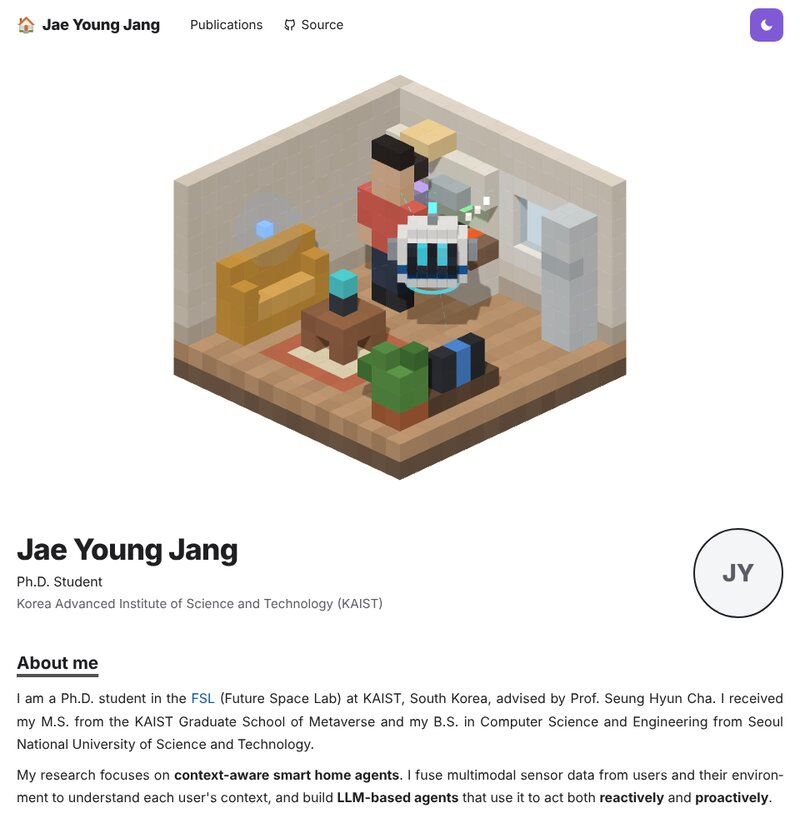

# Jae Young Jang

Personal homepage of Jae Young Jang, Ph.D. student at the [Future Space Lab](https://fsl.kaist.ac.kr/), KAIST.

**https://jaebbang0421.github.io**

## Built with

- HTML, CSS and JavaScript, with no build step
- [three.js](https://threejs.org/) for the voxel smart home scene, generated in code
- [GitHub Pages](https://pages.github.com/) for hosting

## Credits

The layout is inspired by [Takuya Matsuyama's website](https://www.craftz.dog/).
